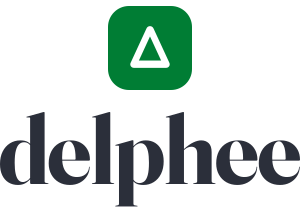

<p align="center">
  
</p>

# Delphee

[English](README.md)

Delphee è un servizio HTTP non ufficiale per il portale studenti Delphi dell'Università degli Studi di Roma Tor Vergata. Accede con le credenziali dello studente, legge le pagine del portale e restituisce in JSON i dati disponibili.

Il progetto include anche una piccola interfaccia web e un account demo offline. È un progetto personale e non è affiliato con l'università.

[](https://nodejs.org)
[](LICENSE)

## Cosa offre

- Profilo dello studente e carriera universitaria
- Esami, esami pendenti, verbali aperti e appelli
- Piano di studi
- Tasse, pagamenti e ricevute PDF
- Servizi per gli studenti e codici di attivazione
- Certificati stampabili in PDF
- Un'interfaccia web per consultare gli stessi dati
- Una demo offline che non contatta Delphi

Delphee dipende dalle pagine HTML di Delphi. Una modifica al portale può interrompere una o più funzioni.

## Requisiti

- Node.js 22 o successivo
- npm
- Credenziali studente di Tor Vergata per i dati reali

Le credenziali reali non servono per usare l'account demo.

## Avvio in locale

Clona il repository e installa le dipendenze:

```sh
git clone https://github.com/selfxplanatorium/delphee.git
cd delphee
npm install
```

Avvia il server di sviluppo:

```sh
npm run dev
```

Apri `http://localhost:7822` e accedi con l'account demo:

| Campo | Valore |
| --- | --- |
| Matricola | `0000000` |
| Password | `demo` |

La demo usa dati di esempio e blocca le richieste verso l'esterno. È utile per lavorare sull'interfaccia e per i test manuali, ma non riproduce ogni risposta di un account Delphi reale.

## Richiesta API

Accedi per ottenere un bearer token:

```sh
curl -s -X POST http://localhost:7822/session/login \
  -H 'content-type: application/json' \
  -d '{"matricola":"0000000","password":"demo"}'
```

La risposta ha questa forma:

```json
{
  "token": "TOKEN",
  "state": "logged_in",
  "matricola": "0000000",
  "since": 0,
  "lastError": null
}
```

Usa il token restituito per una rotta dati:

```sh
curl -s http://localhost:7822/anagrafica \
  -H 'Authorization: Bearer TOKEN'
```

Consulta il [riferimento API](docs/api.md) per tutte le rotte, i parametri e gli errori comuni.

## Configurazione

Delphee legge queste variabili d'ambiente opzionali all'avvio:

| Variabile | Valore predefinito | Scopo |
| --- | --- | --- |
| `DELPHI_BASE_URL` | `https://delphi.uniroma2.it` | URL base di Delphi |
| `PORT` | `7822` | Porta del server HTTP |
| `LOG_LEVEL` | `info` | Livello dei log Pino |
| `NODE_ENV` | `development` | Modalità di esecuzione e formato dei log |

Il server carica anche un file `.env` locale, se presente. Le credenziali degli studenti non sono valori di configurazione. I client le inviano a `POST /session/login`.

## Sviluppo e test

Usa gli script del progetto per il normale sviluppo:

```sh
npm run dev
npm run typecheck
npm test
npm run build
npm start
```

I test usano fixture HTML di Delphi anonimizzate. Non richiedono un account studente reale.

## Stato di Docker

Il repository contiene un `Dockerfile` e una configurazione Compose per un servizio collegato a `127.0.0.1:7821`. La build Docker installa le dipendenze da `package.json` e rigenera `package-lock.json` all'interno dell'immagine; i lockfile non vengono intenzionalmente inclusi nel repository.

Leggi [operazioni e deployment](docs/operations.md) prima di usare il servizio fuori dallo sviluppo locale.

## Documentazione

- [Riferimento API](docs/api.md)
- [Architettura](docs/architecture.md)
- [Operazioni e deployment](docs/operations.md)
- [Note sul design dell'interfaccia](DESIGN.md)
- [Indice della documentazione](DOCS.md)

## Sicurezza e privacy

Le sessioni, le credenziali e i dati in cache restano nella memoria del processo. Una sessione inattiva può essere rimossa dopo 30 minuti e il controllo viene eseguito ogni 5 minuti. Anche il logout e l'arresto del processo eliminano lo stato della sessione.

Un bearer token permette di accedere alla sessione Delphee dello studente. Non salvarlo nei log e non inviarlo su una connessione non cifrata. Il server non offre TLS, storage condiviso o una protezione completa per l'esposizione pubblica.

L'applicazione oscura nei log strutturati i campi noti che contengono credenziali. I messaggi di errore del sistema esterno possono comunque contenere dati imprevisti. Considera quindi i log potenzialmente sensibili e configura con attenzione conservazione e accesso.

Leggi [architettura](docs/architecture.md) e [operazioni e deployment](docs/operations.md) per il comportamento completo e i limiti del servizio.

## Stato del progetto

Delphee è un progetto personale e non ufficiale. Dipende da un sistema universitario che il maintainer non controlla. Usalo a tuo rischio, controlla il codice prima di fornire le credenziali e considera necessaria manutenzione quando Delphi cambia.

## Licenza

Delphee è distribuito con [licenza MIT](LICENSE).
