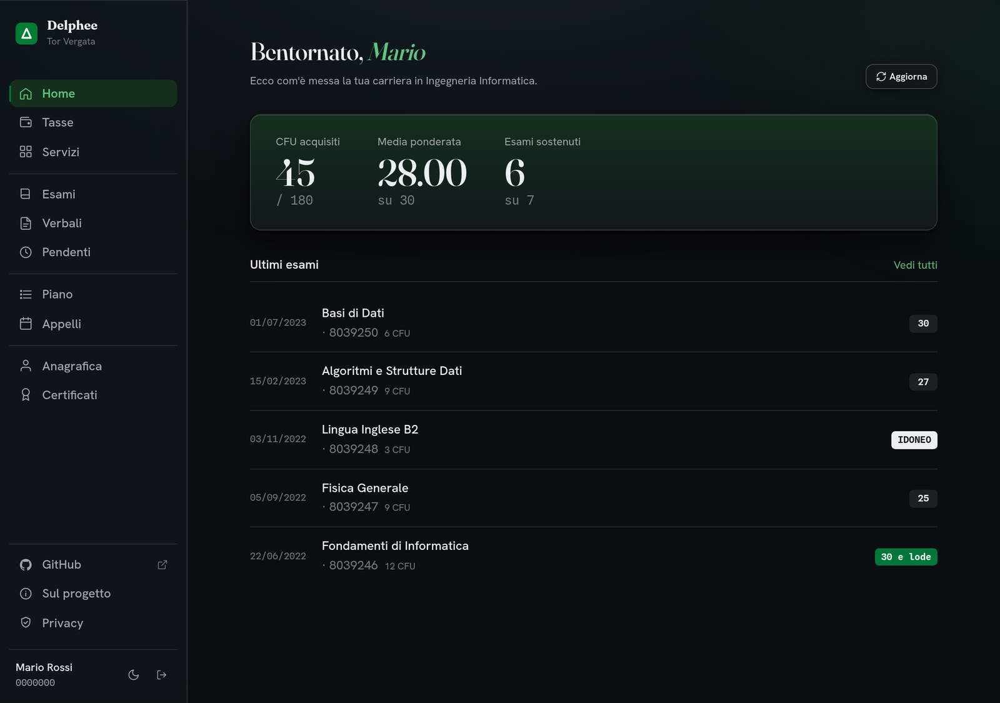
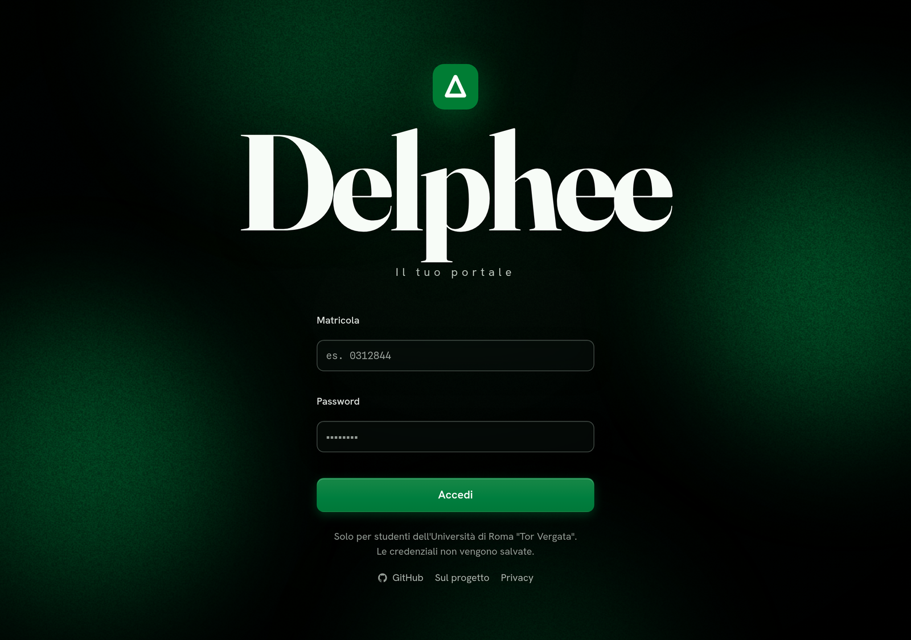
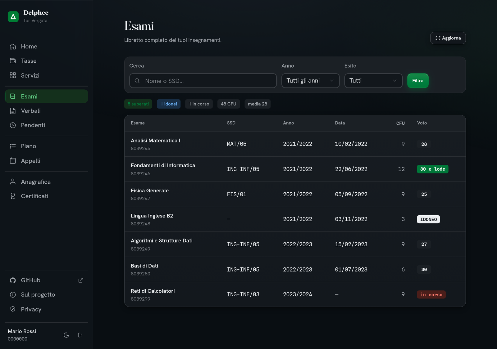

<p align="center">
  
</p>

# Delphee

[Italiano](README.it.md)

Delphee is an unofficial HTTP service for the Delphi student portal at the University of Rome Tor Vergata. It signs in with a student's credentials, reads the portal pages, and returns the available data as JSON.

The project also includes a small browser interface and an offline demo account. It is a personal project and is not affiliated with the university.

[](https://nodejs.org)
[](LICENSE)

## Screenshots

The interface below is running with the offline demo account, so every name,
grade, and identifier shown is sample data.



| Login | Exam record |
| --- | --- |
|  |  |

## What it provides

- Student profile and academic record
- Exam records, pending exams, open records, and exam sessions
- Study plans
- Fees, payment details, and receipt PDFs
- Student services and activation codes
- Printable certificate PDFs
- A browser interface for the same data
- An offline demo that does not contact Delphi

Delphee depends on Delphi's HTML pages. A portal change can break one or more features.

## Requirements

- Node.js 22 or newer
- npm
- Tor Vergata student credentials for live data

You do not need real credentials to use the demo account.

## Run locally

Clone the repository and install the dependencies:

```sh
git clone https://github.com/selfxplanatorium/delphee.git
cd delphee
npm install
```

Start the development server:

```sh
npm run dev
```

Open `http://localhost:7822` and sign in with the demo account:

| Field | Value |
| --- | --- |
| Student ID | `0000000` |
| Password | `demo` |

The demo uses sample data and blocks outbound requests. It is suitable for UI work and manual testing, but it does not reproduce every response from a live Delphi account.

## Make an API request

Sign in to obtain a bearer token:

```sh
curl -s -X POST http://localhost:7822/session/login \
  -H 'content-type: application/json' \
  -d '{"matricola":"0000000","password":"demo"}'
```

The response has this shape:

```json
{
  "token": "TOKEN",
  "state": "logged_in",
  "matricola": "0000000",
  "since": 0,
  "lastError": null
}
```

Use the returned token on a data endpoint:

```sh
curl -s http://localhost:7822/anagrafica \
  -H 'Authorization: Bearer TOKEN'
```

See the [API reference](docs/api.md) for all routes, parameters, and common errors.

## Configuration

Delphee reads these optional environment variables at startup:

| Variable | Default | Purpose |
| --- | --- | --- |
| `DELPHI_BASE_URL` | `https://delphi.uniroma2.it` | Delphi base URL |
| `PORT` | `7822` | HTTP server port |
| `LOG_LEVEL` | `info` | Pino log level |
| `NODE_ENV` | `development` | Runtime mode and log formatting |

The server also loads a local `.env` file when present. Student credentials are not configuration values. Clients submit them to `POST /session/login`.

## Develop and test

Use the project scripts for normal development:

```sh
npm run dev
npm run typecheck
npm test
npm run build
npm start
```

The tests use anonymized HTML fixtures from Delphi. They do not need a live student account.

## Docker status

The repository contains a `Dockerfile` and a Compose configuration for a service bound to `127.0.0.1:7821`. The Docker build installs dependencies from `package.json` and regenerates `package-lock.json` inside the image; lockfiles are intentionally not tracked in this repository.

See [operations and deployment](docs/operations.md) before using the service outside local development.

## Documentation

- [API reference](docs/api.md)
- [Architecture](docs/architecture.md)
- [Operations and deployment](docs/operations.md)
- [UI design notes](DESIGN.md)
- [Documentation index](DOCS.md)

## Security and privacy

Sessions, credentials, and cached student data are held in process memory. An idle session becomes eligible for removal after 30 minutes, and the cleanup task runs every 5 minutes. Logout and process shutdown also remove session state.

A bearer token grants access to that student's Delphee session. Do not log it or send it over an unencrypted connection. The server does not provide TLS, shared storage, or a hardened public edge.

The application redacts known credential fields in structured logs. Upstream error messages can still contain unexpected content, so treat logs as potentially sensitive and configure their storage and retention accordingly.

Read the [architecture](docs/architecture.md) and [operations guide](docs/operations.md) for the complete behavior and deployment limits.

## Project status

Delphee is a personal, unofficial project. It relies on a university system that the maintainer does not control. Use it at your own risk, review the code before providing credentials, and expect maintenance when Delphi changes.

## License

Delphee is available under the [MIT License](LICENSE).
